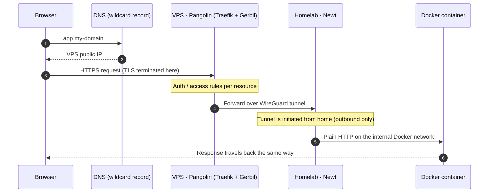
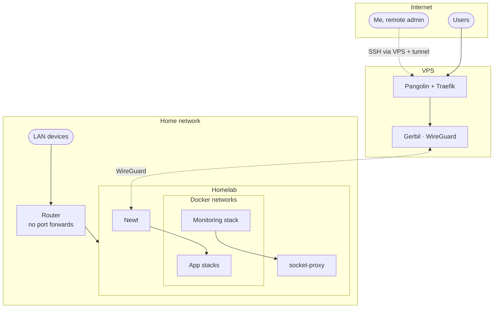

# Architecture & Network

## Publishing services without opening ports

The home connection has **no port forwarding at all**. Public services are published through
[Pangolin](https://github.com/fosrl/pangolin), a self-hosted tunnelled reverse proxy running on a small VPS:

- **Pangolin** manages resources (one per subdomain), certificates and optional authentication.
- **Gerbil** is the WireGuard endpoint on the VPS; **Newt** runs on the homelab as a container and dials out to it.
- Adding a new public service = one Pangolin resource pointing at `container:port`. No firewall or router change.
- The VPS only runs the proxy stack — no data lives there, so it can be rebuilt quickly.

!!! note "Why not Cloudflare Tunnel?"
    I started with Cloudflare Tunnel and migrated to Pangolin in early 2026. Self-hosting the proxy
    removes upload size limits, keeps TLS termination on infrastructure I control, and taught me
    how this kind of tunnel actually works.

## Network overview

| Access path | Used for |
| --- | --- |
| **Public (Pangolin)** | Services I or family use from anywhere: photos, media, calendars, documents |
| **LAN only** | Everything else; most admin UIs are never published |
| **SSH via the tunnel** | Remote administration: an SSH `ProxyCommand` hops through the VPS and into the WireGuard tunnel, so SSH is never exposed to the internet |

## Docker layout

- Every app is its **own Compose project** in `selfhosted/<app>/`, with its own network.
- A custom **address pool** in the Docker daemon gives each network a small `/24`, so dozens of projects never run out of subnets.
- Containers that need the Docker API (dashboards, monitoring) talk to a **read-only socket proxy**, never to `/var/run/docker.sock` directly.
- Logs use the `json-file` driver with rotation (5 × 10 MB per container) so a noisy container cannot fill the disk.
- The NVIDIA runtime is configured for the discrete GPU (used for hardware-accelerated workloads).
- Updates are **manual and deliberate**: I moved away from fully automatic updates (Watchtower) to stay in control of breaking changes.

## External services

| Service | Role |
| --- | --- |
| VPS (IONOS) | Pangolin reverse proxy |
| Small VPS (IONOS) | Private Syncthing relay server, so my devices sync quickly even behind strict NATs (previously a k3s playground) |
| OVH | Domain and DNS, Object Storage for Restic backups |
| Hetzner Storage Share | Second offsite copy (rclone over WebDAV) |
| GitHub | Compose files, my own images on GHCR, CI/CD |
