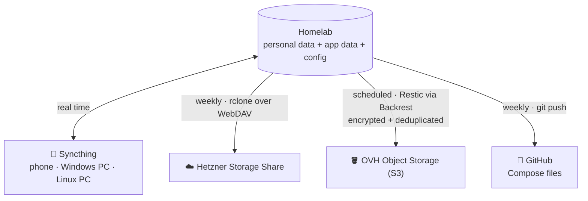
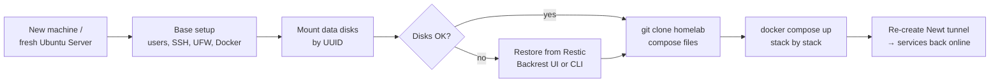

# Backups & Disaster Recovery

## 3-2-1 strategy

> **3** copies of the data · on **2** different media · **1** of them offsite.

| Layer | Destination | Frequency | What |
| --- | --- | --- | --- |
| **Sync** | Syncthing → phone & PCs | Real time | Camera roll, documents, personal folders |
| **Cloud copy 1** | Hetzner Storage Share (rclone, WebDAV) | Weekly | Personal data, scripts, Compose files |
| **Cloud copy 2** | OVH Object Storage (Restic, via Backrest) | Scheduled snapshots | Home directory, both data disks, `/etc` |
| **Config as code** | GitHub ([Jaumoso/homelab](https://github.com/Jaumoso/homelab)) | Weekly, automatic | All active and retired Compose files |

### Why two different offsite tools?

- **Restic** gives encrypted, versioned, deduplicated snapshots — the real backup. I can go back in time if something gets corrupted or deleted.
- **rclone** keeps a plain, browsable copy of personal files that I can open from any device without special tooling.
- Two providers in two companies means one account problem does not take both copies down.

### Making sure backups actually run

- A daily job checks the status of the last Restic runs and alerts if something failed.
- The weekly GitHub push is visible as `Backup automático <date>` commits in the homelab repo — an easy, public heartbeat.
- `rclone` runs with a bandwidth limit so it never saturates the home uplink.

!!! warning "Known limitation"
    Everything is scheduled on the server itself. If the server is down, backups do not run.
    That is why monitoring and alerting matter as much as the backups themselves.

## Disaster recovery

What happens if the server dies tomorrow:

| Scenario | Recovery |
| --- | --- |
| A container breaks after an update | Pin the previous image tag, `docker compose up -d` |
| App data corrupted | Restore that folder from a Restic snapshot |
| System disk fails | Reinstall Ubuntu, base setup, clone Compose files, start stacks — data disks are untouched |
| Data disk fails | Replace disk, restore from Restic (object storage) or rclone copy |
| Whole server lost | All of the above on new hardware; the VPS only needs a new tunnel secret |
| VPS lost | Redeploy Pangolin (stateless apart from its config), point DNS to the new IP |

!!! info "Work in progress: automated rebuild"
    I started an Ansible project to rebuild the base system automatically (packages, users, SSH,
    firewall, Docker, mounts, cron jobs). It fell behind the real server, so it is on the
    [roadmap](../roadmap.md) to be rewritten and tested regularly.
