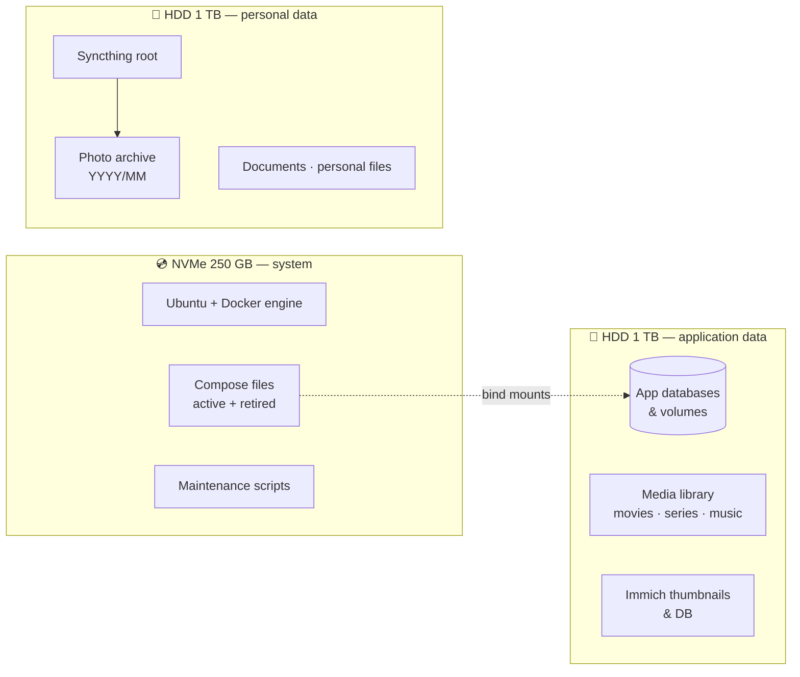

# Hardware & Storage

## The server

The homelab runs on a **repurposed laptop**. It is quiet, sips power, and its battery acts as a built-in UPS for short power cuts.

| Component | Spec |
| --- | --- |
| Machine | HP Pavilion 15 laptop |
| CPU | Intel Core i7-8550U — 4 cores / 8 threads |
| RAM | 16 GB (+ 8 GB swap file) |
| GPU | Intel UHD 620 + NVIDIA MX150 (NVIDIA container runtime enabled) |
| System disk | 250 GB NVMe SSD |
| Data disks | 2 × 1 TB external HDD (USB) |
| OS | Ubuntu Server 22.04 LTS |
| Network | Wi-Fi (5 GHz) — a USB gigabit adapter is ready as fallback |

!!! tip "Constraints are part of the fun"
    Running ~60 stacks on a 2018 laptop forces good habits: resource limits, log rotation,
    stopping what is not needed and starting some services only on demand.

## Disk layout

| Disk | Purpose | Rule |
| --- | --- | --- |
| **NVMe** | OS, Docker images, Compose files, scripts | Nothing that grows indefinitely |
| **HDD — application data** | Persistent volumes, databases, media library | Rebuildable or re-downloadable data |
| **HDD — personal data** | Photos, documents, everything synced with Syncthing | Irreplaceable → backed up twice offsite |

### Mount strategy

- Disks are mounted by **UUID** in `fstab`, never by device name (USB disks can swap `sda`/`sdb` after a reboot).
- The personal-data disk uses `nofail` + `x-systemd.automount`, so a missing disk never blocks the boot.
- `nosuid,nodev` on data disks — they only hold data, never executables.
- Containers use **bind mounts** to the data disks, so app data survives image rebuilds and is included in Restic backups.

## Disk health

- **Scrutiny** and a **smartctl exporter** track S.M.A.R.T. attributes of all three disks.
- Temperatures, reallocated and pending sectors are graphed in Grafana next to the rest of the host metrics.
- An hourly script alerts me when any filesystem crosses a usage threshold, and a disk status report is sent on every boot.

See [Monitoring & Alerting](monitoring.md) for details.
