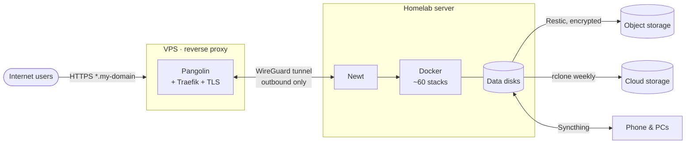

# Homelab

My homelab is the **source of truth for all my personal data** — photos, documents, music, media, notes, location history — and the place where I learn and practise infrastructure work outside my day job.

## At a glance

| | |
| --- | --- |
| **Hardware** | Repurposed laptop — Intel Core i7 (4C/8T), 16 GB RAM, NVMe + 2 × 1 TB HDD |
| **OS** | Ubuntu Server 24.04 LTS (upgraded in place from 22.04) |
| **Workloads** | Docker Engine + Compose, ~60 active stacks, 60+ retired ones kept for reference ([full list](services.md)) |
| **Exposure** | Pangolin reverse proxy on a VPS, WireGuard tunnel (Newt), wildcard domain with TLS |
| **Remote admin** | Key-only SSH tunnelled through the VPS — no SSH exposed to the internet |
| **Backups** | 3-2-1: Syncthing · weekly rclone to cloud storage · Restic (Backrest) to object storage |
| **Monitoring** | Prometheus · Grafana · Loki · Beszel · Scrutiny · ntfy |
| **Config as code** | All Compose files in [Jaumoso/homelab](https://github.com/Jaumoso/homelab), pushed automatically every week |

## Design principles

1. **Own the data.** Photos, documents and history live on disks I control; cloud is only used for encrypted backups.
2. **Nothing exposed at home.** The router has no port forwarding. Public services go through an outbound tunnel to a VPS.
3. **SSD for config, HDD for data.** The NVMe only holds the OS, Docker and configuration — nothing that grows unbounded. Everything that grows lives on the data disks.
4. **Never delete a stack.** Retired stacks are moved to `unused/` with their config intact, so trying something again takes minutes.
5. **If it is not monitored, it is not running.** Every critical piece has a metric, a log stream or an alert.

## Sections

- [Architecture & Network](architecture.md) — how traffic flows and how services are published
- [Hardware & Storage](hardware-storage.md) — disks, layout and data organisation
- [Services](services.md) — the full, auto-generated catalogue
- [Backups & Disaster Recovery](backups.md) — 3-2-1 strategy and recovery plan
- [Monitoring & Alerting](monitoring.md) — metrics, logs, disk health and notifications
- [Security](security.md) — hardening and access model
- [Use Cases](use-cases.md) — how the pieces fit together in daily life
- [Lessons Learned](lessons-learned.md) — real incidents and what I changed
