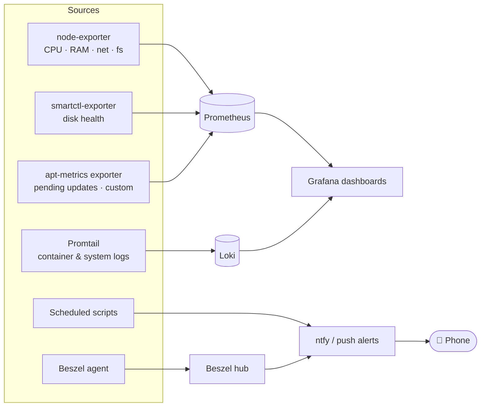

# Monitoring & Alerting

## Stack

| Tool | Role |
| --- | --- |
| **Prometheus** | Time-series metrics from node-exporter, smartctl-exporter and a custom exporter |
| **Grafana** | Dashboards for host, containers, disks and logs |
| **Loki + Promtail** | Centralised logs for all containers and the host — searchable from Grafana |
| **Beszel** | Lightweight per-container CPU/RAM/network view and threshold alerts, for both the homelab and the VPS |
| **Scrutiny** | S.M.A.R.T. history and failure prediction for every disk |
| **ntfy** | Self-hosted push notifications to my phone |
| **changedetection.io** | Watches external web pages for changes |

## Custom APT metrics exporter

Prometheus has no built-in way to see **pending OS updates**, so I wrote a small Python exporter
that runs as a systemd service on both the homelab and the VPS. It exposes:

- number of upgradable packages and their total download size
- timestamp of the last upgrade and count of successful upgrades
- whether `unattended-upgrades` is running

A Grafana panel shows both machines side by side, so I know when patching is due.

## Scheduled health checks

Maintenance scripts are managed from a web UI (**Cronmaster**) so their schedule, last run and logs are visible:

| Job | Schedule | What it does |
| --- | --- | --- |
| Network watchdog | every few minutes | Checks gateway and DNS; restarts the Wi-Fi interface with retries, reboots only as a last resort (and never during an image pull) |
| Container health check | every 15 min | Detects unhealthy or crashed containers |
| Disk usage alert | hourly | Alerts when a filesystem crosses a threshold |
| Backup status | daily | Verifies the latest Restic snapshots succeeded |
| Docker cleanup | weekly | Removes dangling images and orphaned volumes (conservatively) |
| Compose backup to GitHub | weekly | Commits and pushes all Compose files |
| Cloud sync | weekly | rclone copy to the second offsite location |
| Boot report | on reboot | Notifies that the server restarted, with disk status |
