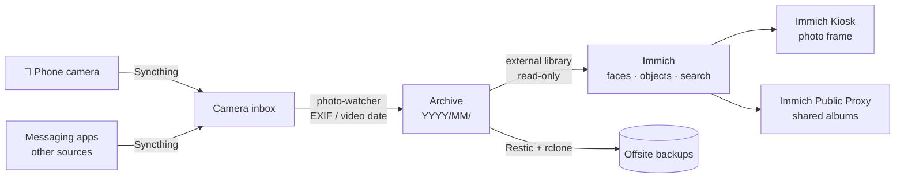
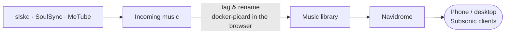
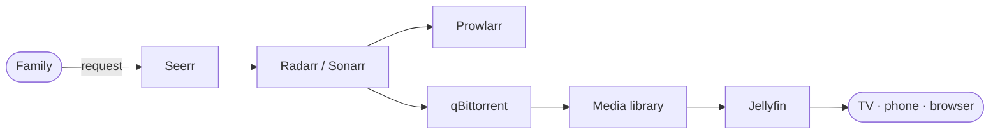

# Use Cases

How the pieces fit together in everyday life.

## 📸 Photos: from the phone to a searchable library

I replaced Google Photos with a pipeline where every photo ends up as a plain file in a dated folder **and** in a searchable gallery.

- **[photo-watcher](https://github.com/Jaumoso/photo-watcher)** is a small Python service I wrote (with unit tests, shipped as a Docker image). It watches the inbox folders, waits until each file is fully synced, reads the date from EXIF / video metadata (falling back to file time) and copies it into the `YYYY/MM` archive. Deletions are mirrored too, but only after a SHA-256 check confirms it is the same file.
- **Immich** indexes the archive as an *external library*, so files stay in a simple folder structure, independent of any app. If Immich disappeared tomorrow, the photos would still be perfectly organised.
- The archive is the most backed-up data on the server (see [Backups](backups.md)).

## 🎵 Music: tagging and streaming my own library

Tagging music with MusicBrainz Picard needs a desktop app, but the files live on a headless server.
So I packaged Picard in a container with a virtual display and noVNC:
**[docker-picard](../projects/docker-picard.md)** lets me tag the server's library straight from the browser.

## 🎬 Movies & TV for the family

Requests go through one simple UI; everything else is automated and ends up in Jellyfin.

## 🗺️ Location history

**Dawarich** stores my location history privately (a self-hosted Google Timeline).
To clean up and enrich trips I wrote a small CLI and a local web editor that talk to its API — importing GPX tracks, fixing wrong points and checking import status — without touching the database directly.

## 📄 Paperwork

Scanned letters, invoices and contracts go to **Paperless-ngx** (OCR + auto-tagging). **Stirling-PDF** and **SnapOtter** handle conversions locally, so documents never have to be uploaded to random websites.

## 🗓️ Photo calendars

Designing photo wall calendars turned into my biggest side project:
**[Kalenda](../projects/kalenda.md)**, a self-hosted calendar designer with photos, stickers and text that exports print-ready PDF/PNG files.
It runs on the homelab like any other stack.
