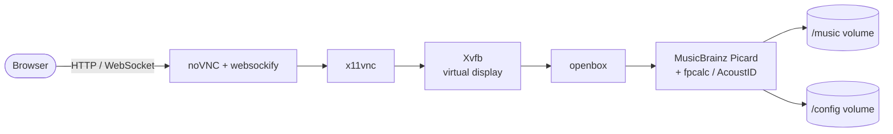

# docker-picard

**[MusicBrainz Picard](https://picard.musicbrainz.org/) in Docker, with web access through noVNC.**
Manage music metadata from the browser without installing anything locally.

[:fontawesome-brands-github: Source code](https://github.com/Jaumoso/docker-picard){ .md-button .md-button--primary }
[:material-docker: Image on GHCR](https://github.com/Jaumoso/docker-picard/pkgs/container/docker-picard){ .md-button }

## Why

My music library lives on the homelab, which has no screen. Picard is a desktop application, and
copying the library back and forth to tag it on a laptop was slow and error-prone.
Running Picard **next to the files** and opening it in a browser solved it.

## How it works



| Component | Role |
| --- | --- |
| Alpine Linux | Small base image |
| Xvfb | Virtual X display, no GPU or monitor needed |
| openbox | Minimal window manager |
| x11vnc + noVNC/websockify | Streams the display to the browser |
| fpcalc (Chromaprint) | Acoustic fingerprinting to identify untagged tracks |
| GitHub Actions | Builds the image and publishes it to GHCR |

## Usage

```yaml
services:
  picard:
    image: ghcr.io/jaumoso/docker-picard:latest
    ports:
      - "6080:6080"
    volumes:
      - ./config:/config
      - /path/to/music:/music
    environment:
      - RESOLUTION=1920x1080x24
    restart: unless-stopped
```

Open `http://localhost:6080` and tag away. On my server it sits in the [music workflow](../homelab/use-cases.md#music-tagging-and-streaming-my-own-library) between the download tools and Navidrome.
