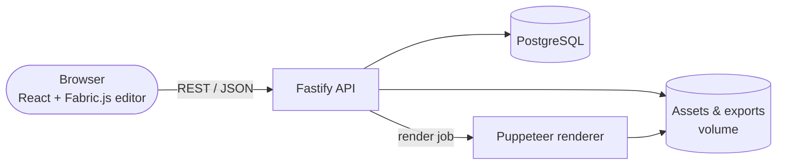

# Kalenda

<p align="center">
  
</p>

**Self-hosted calendar design and export application.**
Create fully customisable wall calendars — photos, stickers, text and visual styles across the twelve months plus covers — and export them as production-ready **PDF** or **PNG** files.

[:fontawesome-brands-github: Source code](https://github.com/Jaumoso/kalenda){ .md-button .md-button--primary }
[:material-tag: Releases](https://github.com/Jaumoso/kalenda/releases){ .md-button }

## Status

| | |
| --- | --- |
| **Latest release** | v0.1.x — actively developed |
| **Deployment** | Running on my homelab behind Pangolin, installed from the published images |
| **Next** | User guide, full review on the real server, tested backup restore and rollback between `dev` and stable |

## Tech stack

| Layer | Technologies |
| --- | --- |
| Frontend | React 19, Vite, Tailwind CSS 4, **Fabric.js** canvas editor, Zustand, TanStack Query, i18next |
| Backend | Fastify 5, Prisma, PostgreSQL 16, Zod |
| Rendering | Sharp for images, **Puppeteer** in a dedicated container for PDF/PNG export |
| Tooling | TypeScript, pnpm workspaces monorepo (`apps/frontend`, `apps/backend`, `packages/shared`), ESLint, Prettier, Vitest, **Playwright** E2E |
| Delivery | Docker Compose, multi-image release to GHCR, GitHub Actions |

## Architecture



## Engineering practices

- **Release flow:** `main` is stable, `dev` is the integration branch. Every push to `dev` publishes development images; stable releases follow SemVer tags and are back-merged to `dev` automatically.
- **CI:** dependency audits, lint, build and unit tests on every PR, a Docker Compose smoke test (stack up + health checks), and Playwright end-to-end tests against a seeded database.
- **Security hygiene:** Dependabot, `pnpm audit` kept at zero known vulnerabilities, overrides for vulnerable transitive dependencies.
- **Safe defaults:** the production Compose file refuses to start without explicit database, admin and signing secrets; public registration is off by default.
- **Planning in the open:** PRD, user stories, architecture, API and roadmap documents live in the repo; changes are tracked in a changelog.

## Try it

```bash
mkdir kalenda && cd kalenda
curl -fsSL https://raw.githubusercontent.com/Jaumoso/kalenda/main/docker-compose.yml -o docker-compose.yml
# create .env with DB, admin and secrets (see README), then:
docker compose up -d
```
