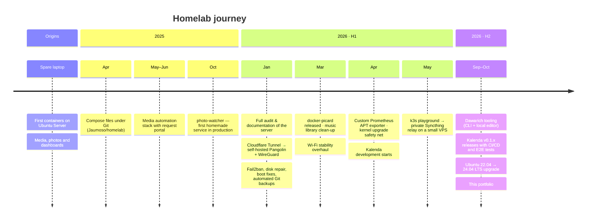

# Timeline

How the homelab and my projects have evolved. Dates come from Git history and my own notes.

## Details

### Origins
A spare **HP laptop** became an Ubuntu server. It started with a handful of containers (media and photos)
and grew stack by stack. Dozens of apps were tried along the way — the ones I stopped using are
kept in [`unused/`](https://github.com/Jaumoso/homelab/tree/main/unused), a nice record of what I experimented with.

### 2025
- **April** — All Compose files versioned in [Jaumoso/homelab](https://github.com/Jaumoso/homelab).
- **May–June** — Media automation (*arr stack + request portal) for the family.
- **October** — Wrote [photo-watcher](https://github.com/Jaumoso/photo-watcher) to feed the photo archive automatically.

### 2026
- **January** — Big audit of the whole server, documented end to end. Moved from Cloudflare Tunnel to **Pangolin + Newt** on my own VPS; removed Tailscale. Enabled Fail2ban, repaired a data disk, fixed a corrupt initramfs, fixed the weekly GitHub backup (automated commits ever since). VPS migrated to a new IP.
- **March** — Published [docker-picard](projects/docker-picard.md). Deduplicated and cleaned the music library with scripts. Fixed recurring Wi-Fi drops at the root (see [Lessons Learned](homelab/lessons-learned.md)).
- **April** — Custom **APT metrics exporter** for Prometheus on both servers. Hardened GRUB/initramfs against bad kernel upgrades. Started **[Kalenda](projects/kalenda.md)**.
- **May** — Replaced a resource-hungry k3s test cluster on a small VPS with a private **Syncthing relay**. Drew the full infrastructure diagram.
- **September–October** — Built a CLI and local web editor for Dawarich location data. Kalenda reached v0.1.10 with a full release pipeline. Published this site.
- **2026** — Upgraded the server in place from Ubuntu 22.04 to **24.04 LTS** without issues.
